# T30 Watch

An open-source Android app for the **T30 smartwatch** (a Veepoo device). It replaces Veepoo's "H Band" app.

**Nothing leaves your phone.** The app has no internet permission. It can't send your data, your phone details,
or your watch's MAC address to Veepoo or anyone else. Your data stays in the app and goes only where you export it.

> Not a medical device. Wrist blood pressure is an optical estimate. Check worrying readings with a cuff and a doctor.

<p align="center">
  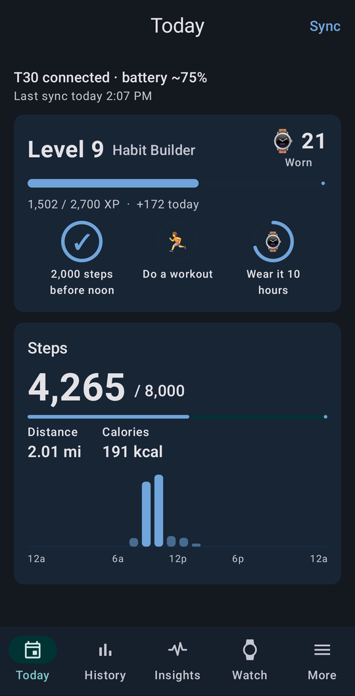
  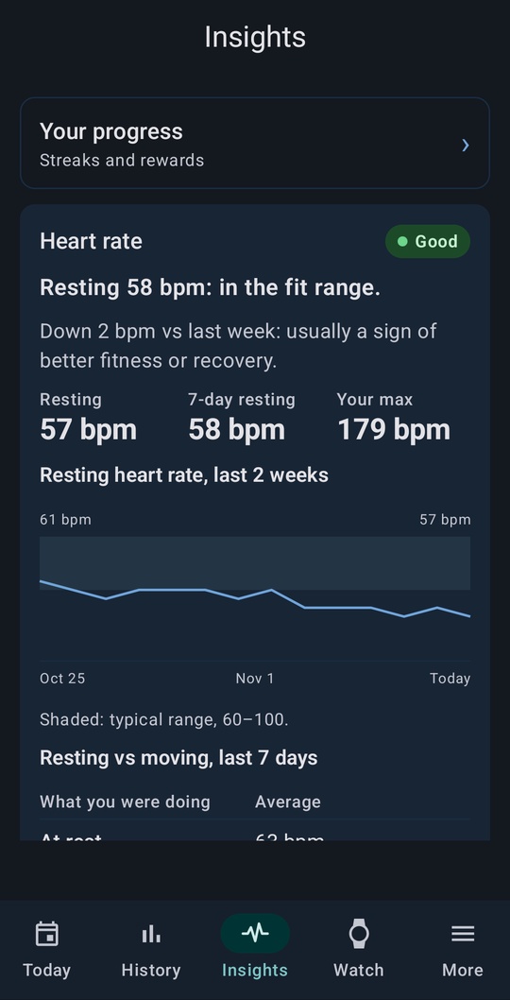
  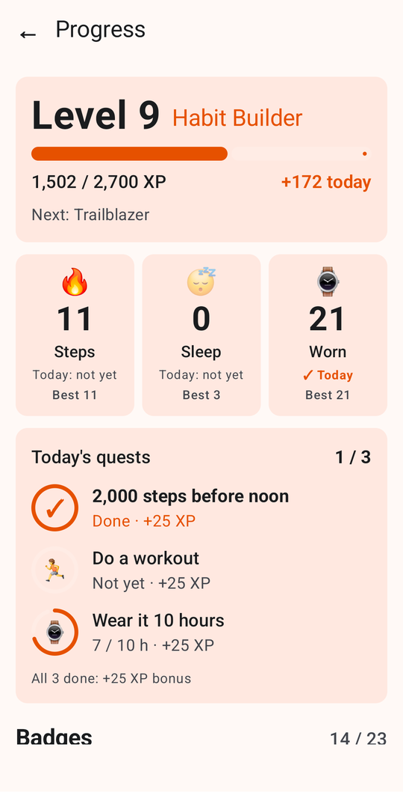
  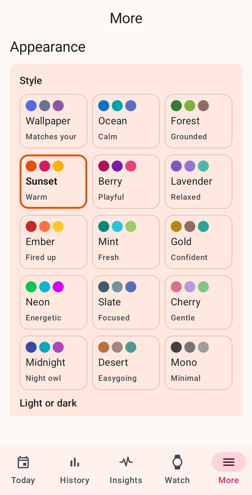
</p>

## Screenshots

Screenshots use made-up demo data (see [Demo build](#demo-build)).

| Today | Heart rate | Insights: heart | Insights: blood pressure |
|---|---|---|---|
| 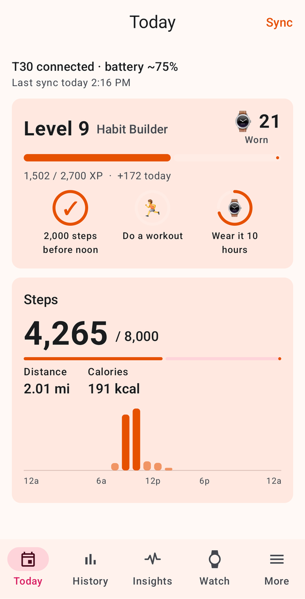 | 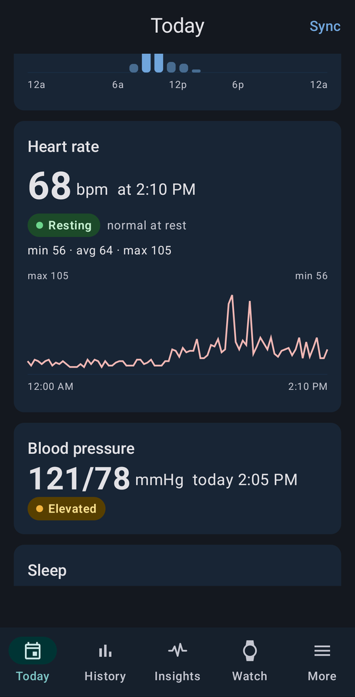 | 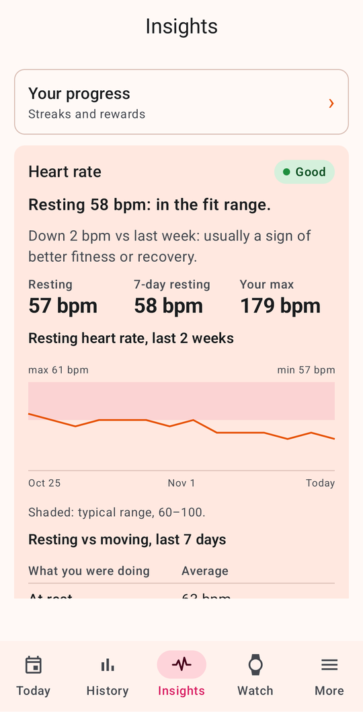 | 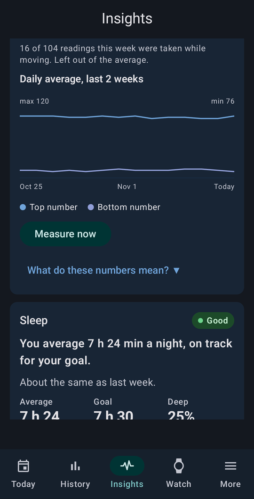 |

| Progress | Badges | New badge pop-up | Workouts + personal bests |
|---|---|---|---|
| 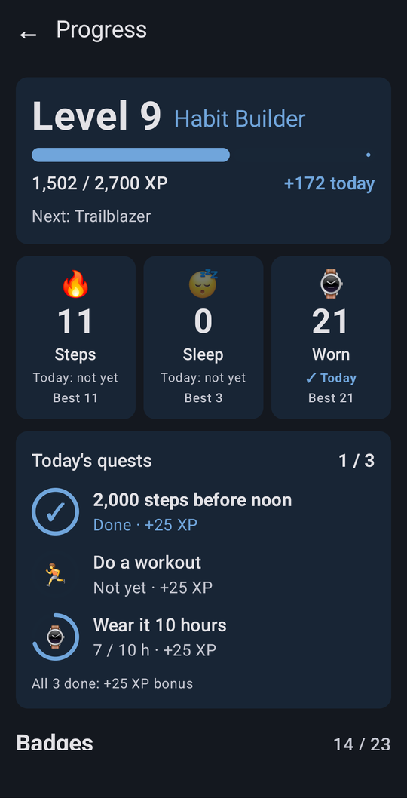 | 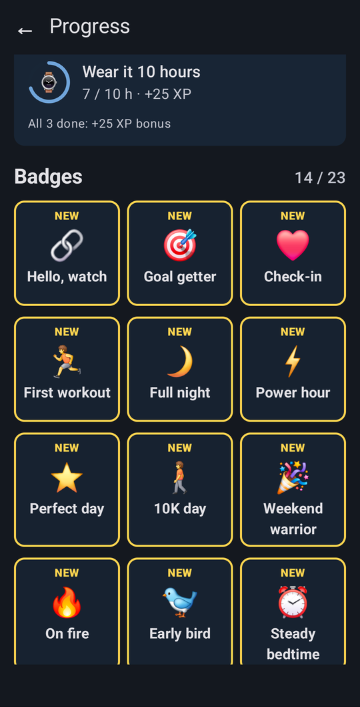 | 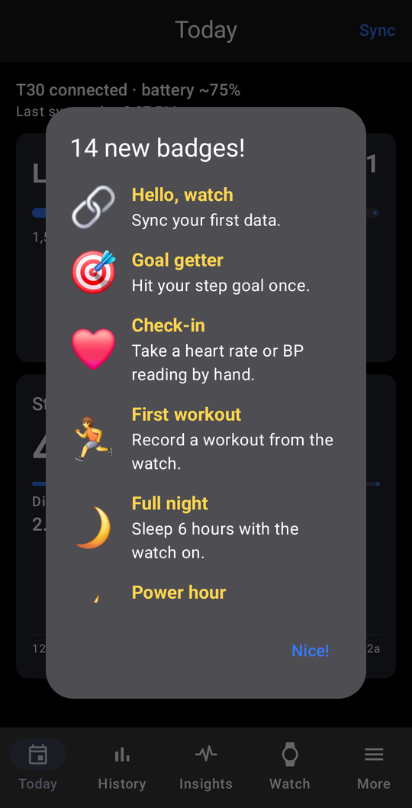 | 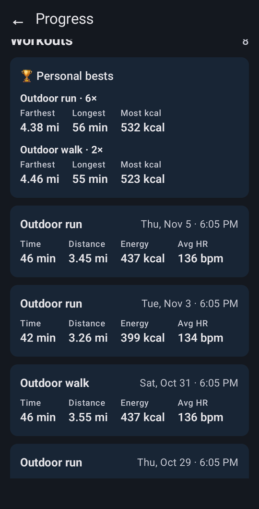 |

| History: heart rate | History: sleep | Themes |
|---|---|---|
| 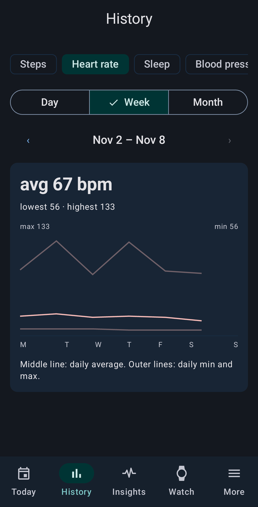 | 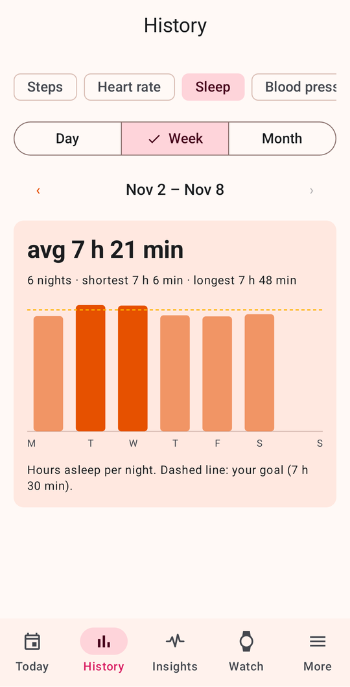 |  |

## What it does

| Tab | What you get |
|---|---|
| **Today** | Steps vs goal with an hourly chart, distance, calories, heart rate (labelled resting or active), latest blood pressure with its category, last night's sleep, your level and today's quests |
| **History** | Steps, heart rate, sleep and blood pressure by day, week or month |
| **Insights** | What your numbers mean: resting heart rate and its trend, heart-rate zones, blood pressure category (American Heart Association ranges) with readings taken while moving flagged, sleep consistency with tips, activity trend |
| **Watch** | Connect, battery, measure heart rate or blood pressure live, watch settings, feature list |
| **More** | Profile (US or metric units), 15 colour styles + dark mode, background connection, notifications to the watch, CSV and Health Connect export |

The **Progress** screen covers:
- XP and levels
- streaks for steps, sleep and wear
- 3 daily quests
- 23 badges
- a weekly recap
- a workout log with personal bests

**Watch settings** covers:
- 12 or 24 hour clock, units
- automatic heart rate and blood pressure
- heart-rate alarm, sedentary reminder
- raise-to-wake, screen-on time
- alarms
- which notification types the watch shows
- language
- remote camera shutter (shake the watch to take a photo)

**Background:**
- The app keeps the watch connected and reconnects on its own.
- It syncs only new data every hour.
- It forwards phone notifications to the watch, and pauses forwarding while the phone is in Do Not Disturb.

Firmware updates and watch-face uploads are **not** included. They can brick the watch.

## Will it work with my watch?

It's built and tested on a **T30** (Veepoo model 3238, firmware 03.01.01).
Other Veepoo watches that work with H Band will probably connect too. The app reads the watch's own feature list
and hides anything the watch doesn't support. Open an issue with your watch's Debug screen dump if something's off.

Before connecting, **close or uninstall H Band** (the watch accepts one app at a time).
The same goes for BLE tools like nRF Connect, which can hold the connection in the background.

## Install

**Option 1: download.** Get the `.apk` from [Releases](../../releases). Open it on the phone and allow
"install unknown apps".

**Option 2: build it yourself.**

1. Install [Android Studio](https://developer.android.com/studio) (it includes the JDK and Android SDK).
2. Clone this repo and open the folder in Android Studio.
3. Plug in your phone with USB debugging on, then press **Run ▶**.

   From a terminal: `./gradlew :app:installDebug` (Windows: `.\gradlew.bat :app:installDebug`).

Requires Android 8.0 or newer.

### Demo build

Want to look around without a watch? The demo build installs next to the real app (its own data), fills itself with
three weeks of made-up data, and never uses Bluetooth:

```sh
./gradlew :app:installDemo
```

It's also in [Releases](../../releases) as `t30-watch-demo-*.apk`.

## First run

1. Allow Bluetooth when asked.
2. **Watch** tab → **Scan** → tap your watch. The default password is `0000`.
3. **More → Profile**: enter height, weight and age, then **Save**. The watch uses them for calories and distance.
4. Optional: **More → Notifications** → allow Notification access to get phone notifications on the watch.
5. Optional: **More → Background** → set battery to *Unrestricted* so the connection survives.

## How it's built

Kotlin, Jetpack Compose (Material 3), Hilt, Room, coroutines. It talks to the watch through
[Veepoo's official SDK](https://github.com/HBandSDK/Android_Ble_SDK), included in `app/libs` under its Apache 2.0 license.
Every watch command goes through one serialized queue, because the watch corrupts data if commands overlap.

| Folder | Contents |
|---|---|
| `app/src/main/java/com/t30watch/ble/` | SDK wrapper, command queue, raw callback log |
| `data/` | Room database, sync engine, settings |
| `insights/`, `game/` | Health maths and game rules (plain Kotlin, unit tested) |
| `ui/` | Compose screens |
| `docs/sdk-notes.md` | Everything learned about the SDK: call order, quirks, gotchas |
| `docs/t30-support.md` | What the T30 actually supports |

Run the tests with `./gradlew :app:testDebugUnitTest`.

## License

The app code is under the [MIT license](LICENSE). The Veepoo SDK files in `app/libs` and `app/src/main/jniLibs` belong to
Veepoo and are under [Apache 2.0](app/libs/LICENSE-Veepoo-SDK.txt). See [THIRD_PARTY_NOTICES.md](THIRD_PARTY_NOTICES.md).

This project has no connection to Veepoo or H Band.
